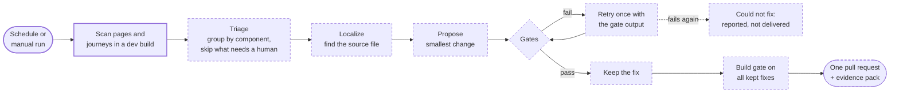
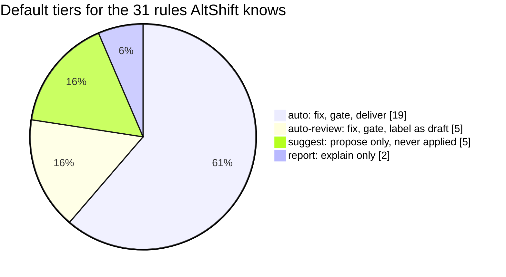
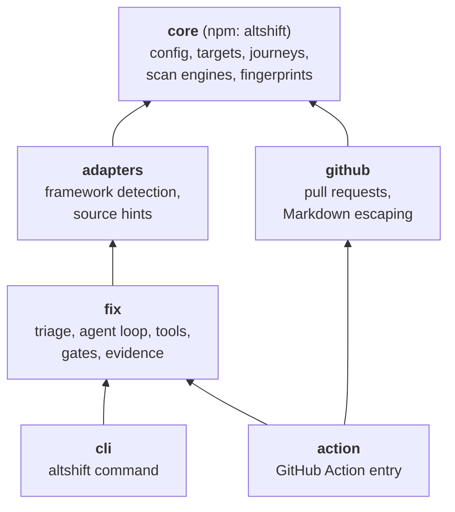

# AltShift

**Accessibility debt, fixed in pull requests you can merge with confidence.**

AltShift scans a storefront's dev build, asks Claude for the smallest source change that clears each finding, and then proves every change with plain-code gates before a person sees it: your own typecheck, lint and build, a rescan, and a visual diff. Fixes that pass land in one pull request with an evidence pack. Fixes that fail are dropped and explained.

Built for Nuxt and Vue storefronts first. Next.js is next.

> **Status: early.** The scanner works today (`altshift scan`). The fix engine, the pull request delivery and the GitHub Action are being built in the open. See [What works today](#what-works-today) before you plan around it.

---

## Why this exists

Finding accessibility issues is a solved problem. axe, Lighthouse and others will hand you a list for free.

Fixing them is where the time goes. Someone has to find the component behind each finding, make the change in the house style, check that nothing broke, and repeat that a few hundred times. Agencies do it across many client repos, and then have to show the client what was done.

AI coding agents can write those fixes, but an unreviewed agent diff is a liability: it can break the build, shift the layout, or "fix" a rule by hiding the element. AltShift's position is simple:

- **The model proposes. Code decides.** No model is ever asked whether its own fix is good enough.
- **Nothing reaches your team unless it passed every gate.**
- **Every fix comes with evidence** a reviewer, or an agency's client, can read.

## How it works



Solid boxes are built. Dashed boxes are on the [roadmap](#roadmap).

### The gates

Every proposed change runs through these in order. The first failure stops it.


All six are deterministic code. They give the same answer every time, and they do not depend on the model being honest or correct.

### What gets fixed, and what does not

Each axe rule sits in a tier that decides how far AltShift is allowed to go. Rules it does not know are never auto-fixed.



| Tier          | What happens                                                                   | Examples                                                               |
| ------------- | ------------------------------------------------------------------------------ | ---------------------------------------------------------------------- |
| `auto`        | Fixed, gated and delivered                                                     | `button-name`, `link-name`, `label`, `select-name`, `list`, ARIA rules |
| `auto-review` | Fixed and gated. The text the model wrote is marked "Draft: please review."    | `image-alt`, `svg-img-alt`                                             |
| `suggest`     | A proposed diff in the evidence pack. Never applied, because it changes design | `color-contrast`, `target-size`                                        |
| `report`      | Explained only. Needs content a person must supply                             | `video-caption`, any unknown rule                                      |

You can move a rule to a stricter or looser tier in config.

## What works today

| Piece                                                        | State   |
| ------------------------------------------------------------ | ------- |
| Config (`altshift.config.ts`), validated with clear errors   | Built   |
| Page targets and Playwright journeys with named check points | Built   |
| axe-core scan engine in Chromium                             | Built   |
| Stable finding fingerprints and deterministic JSON reports   | Built   |
| `altshift scan`                                              | Built   |
| Nuxt 4 fixture storefront with seeded violations             | Built   |
| Fix engine: triage, agent tools, gates, model routing        | Next    |
| `altshift fix --dry-run`, fix evals                          | Next    |
| Pull request delivery, evidence pack, GitHub Action          | Planned |
| Next.js adapter, AccessLint engine, SARIF import             | Planned |

### Try the scanner

AltShift is not on npm yet, so run it from a clone. You need Node 22.18 or newer (24 recommended) and pnpm 10.

```bash
git clone https://github.com/OWNER/altshift.git && cd altshift
```

```bash
pnpm install && pnpm build
```

```bash
pnpm --filter altshift exec playwright install chromium
```

Scan the bundled Nuxt storefront:

```bash
cd fixtures/nuxt-app && node ../../packages/cli/dist/index.js scan
```

AltShift starts the dev server, scans three pages and two interactive states, stops the server and prints what it found. This is real output, shortened:

```text
AltShift scan: axe 4.14.0, 5 checkpoint(s)

/  (load)
  critical  button-name       auto         article:nth-child(1) > .product-card__body > .product-card__wishlist
            Buttons must have discernible text
  critical  label             auto         input
            Form elements must have labels
  serious   link-name         auto         .promo__link
            Links must have discernible text

/products/trail-mug  (load)
  serious   color-contrast    suggest      .product__badge
            Elements must meet minimum color contrast ratio thresholds
  critical  image-alt         auto-review  .product__lifestyle
            Images must have alternative text

/shipping  (load)
  no findings

cart-open  (drawer)
  critical  button-name       auto         .icon-button
            Buttons must have discernible text

15 finding(s): 10 auto, 1 auto-review, 4 suggest, 0 report
```

The third column is the tier: what the fix engine will be allowed to do with that finding. Add `--json` for a machine-readable report. Two scans of the same build produce byte-identical JSON, which is what makes the rescan gate possible.

### Scan your own storefront

Add `altshift.config.ts` to your project root:

```ts
import { defineConfig } from "altshift";

export default defineConfig({
  app: {
    dev: { command: "pnpm dev", url: "http://localhost:3000" },
    build: "pnpm build",
    checks: ["pnpm typecheck", "pnpm lint"],
  },
  targets: {
    pages: ["/", "/products/test-shirt", "/cart"],
    journeys: "./journeys/*.journey.ts",
    exclude: [".third-party-chat-widget"],
  },
});
```

Until the package is published, `defineConfig` cannot be imported from outside this repo. Export the plain object instead (`export default { app: { ... } }`). It is validated the same way.

Pages are paths on the dev server AltShift starts, never full URLs, so a config cannot point a scan at a live site by mistake.

**Journeys** reach states a page load cannot: an open cart, a form showing validation errors. They are ordinary Playwright with one extra call, `check()`:

```ts
import { defineJourney } from "altshift";

export default defineJourney({
  name: "cart-open",
  run: async ({ page, check }) => {
    await page.goto("/products/test-shirt");
    await page.getByRole("button", { name: "Add to cart" }).click();
    await page.getByRole("dialog").waitFor();
    await check("drawer");
  },
});
```

Journeys must stop before placing an order. Use test products and test payment details only, and never run AltShift against production.

Exit codes: `0` the scan completed (findings are a normal result), `2` the config, dev server, browser or a target failed.

## What the model can and cannot do

The fix step uses Claude through your own Anthropic API key. Page content, product data, repo files and comments are all treated as untrusted input, because any of them can carry text written to steer a model.


- The model reads through a small set of tools and can only propose exact-match edits. It never gets a shell, network access or write access.
- `.env` files, denied paths and large files are never sent.
- AltShift never pushes to protected branches, merges or force-pushes. A person reviews every pull request.
- No telemetry.

The fixture storefront ships with a prompt-injection string in its product data, so this is tested, not assumed.

## What AltShift does not claim

Automated testing finds only part of the issues that WCAG covers. AltShift will never tell you a site is accessible, compliant, or safe from legal action, and nothing it produces should be presented that way.

- A fix means: this change cleared the named automated finding and passed the listed gates. A person still needs to review it.
- An evidence pack means: these automated findings were fixed on the tested pages and states. Manual testing is still needed.
- Alt text and accessible names written by the model are always labelled "Draft: please review."

It is also not an overlay. It changes your source code through pull requests and adds nothing to your production pages.

## Roadmap

| Milestone | Scope                                                                                | State   |
| --------- | ------------------------------------------------------------------------------------ | ------- |
| 1         | Scan engine, targets and journeys, fingerprints, `altshift scan`, Nuxt fixture       | Built   |
| 2         | Nuxt adapter, fix engine with tools, gates and model routing, `fix --dry-run`, evals | Next    |
| 3         | Pull request delivery, evidence pack, GitHub Action                                  | Planned |
| 4         | Next.js adapter, AccessLint engine option, SARIF import                              | Planned |
| 5         | Fix-on-label for open pull requests                                                  | Planned |
| Later     | SvelteKit, Astro, Hydrogen, as people ask                                            | Planned |

## Repository layout



Arrows point at what a package depends on. `core` never imports from `fix`.

```text
packages/    the six packages above
fixtures/    small storefronts with seeded violations (nuxt-app today)
evals/       fix eval cases and results
examples/    a config, a journey and a workflow to copy
```

## Development

```bash
pnpm install
```

```bash
pnpm check
```

`pnpm check` runs lint (Biome), typecheck and the unit tests. Unit tests use no network and never call a model.

```bash
pnpm test:fixtures
```

`pnpm test:fixtures` starts the Nuxt fixture, scans it in Chromium and fails unless the scan finds every seeded violation and nothing else.

Working rules for contributors and coding agents are in [AGENTS.md](AGENTS.md). The short version: TypeScript strict, Zod at every boundary, small pure functions, deterministic output, a test with every behaviour change, and no new runtime dependency without asking.

## Licence

[MIT](LICENSE).
