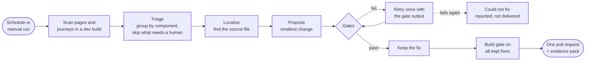
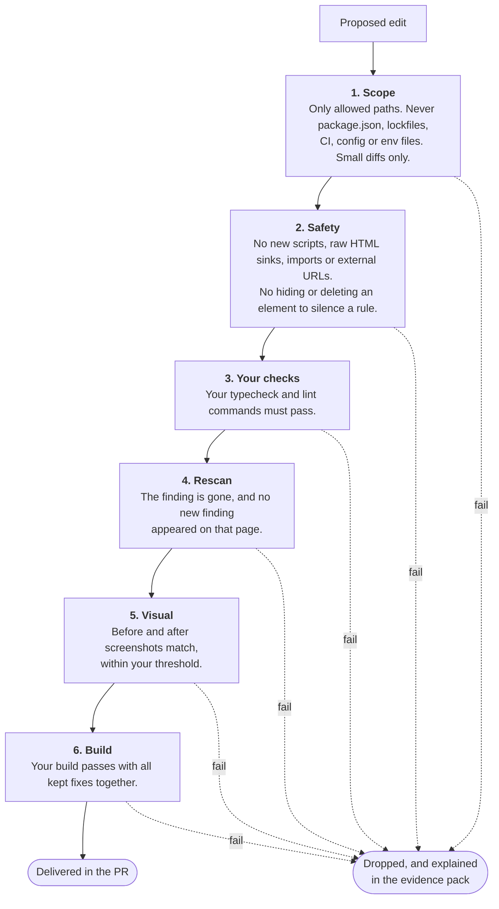
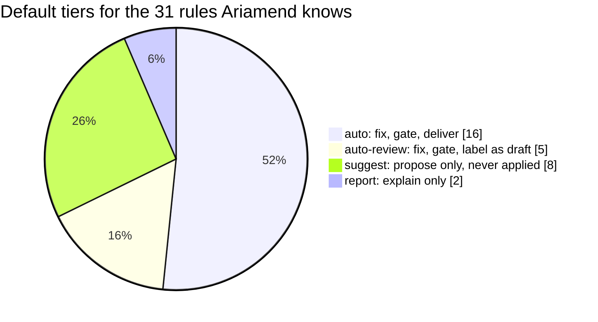
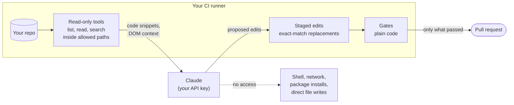
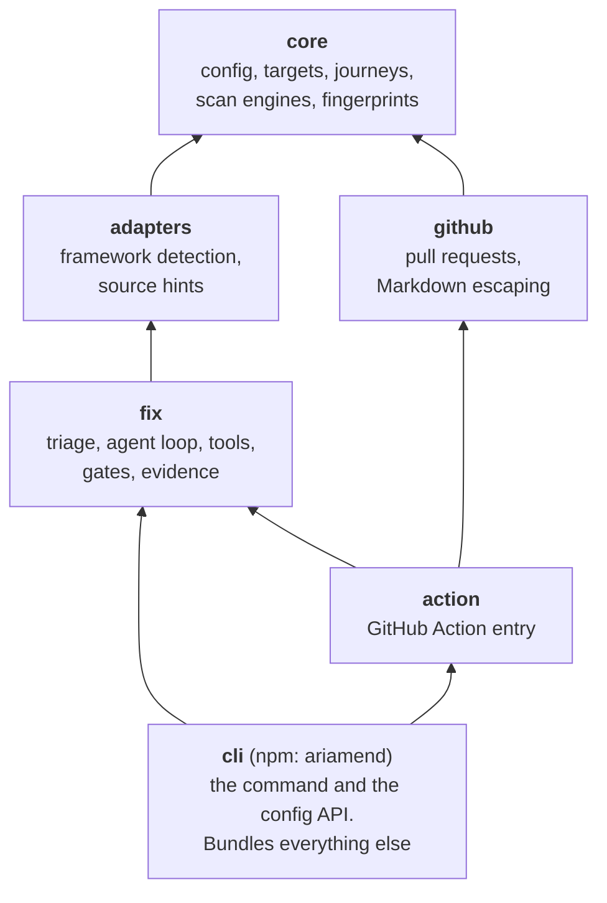

# Ariamend

**Accessibility debt, fixed in pull requests you can merge with confidence.**

Ariamend scans a storefront's dev build, asks Claude for the smallest source change that clears each finding, and then proves every change with plain-code gates before a person sees it: your own typecheck, lint and build, a rescan, and a visual diff. Fixes that pass land in one pull request with an evidence pack. Fixes that fail are dropped and explained.

Built for Nuxt and Vue storefronts first. Next.js is next.

> **Status: early (0.1.0).** Scanning, gated fixing, the evidence pack, pull request delivery and the GitHub Action all work on Nuxt today. Expect rough edges, and review every pull request it opens. See [What works today](#what-works-today) before you plan around it.

[](https://www.npmjs.com/package/ariamend)

The name is ARIA plus _mend_: it repairs accessibility in your source code rather than reporting on it.

---

## Why this exists

Finding accessibility issues is a solved problem. axe, Lighthouse and others will hand you a list for free.

Fixing them is where the time goes. Someone has to find the component behind each finding, make the change in the house style, check that nothing broke, and repeat that a few hundred times. Agencies do it across many client repos, and then have to show the client what was done.

AI coding agents can write those fixes, but an unreviewed agent diff is a liability: it can break the build, shift the layout, or "fix" a rule by hiding the element. Ariamend's position is simple:

- **The model proposes. Code decides.** No model is ever asked whether its own fix is good enough.
- **Nothing reaches your team unless it passed every gate.**
- **Every fix comes with evidence** a reviewer, or an agency's client, can read.

## How it works



Every box runs end to end today, from a clone of this repository.

### The gates

Every proposed change runs through these in order. The first failure stops it.



All six are deterministic code. They give the same answer every time, and they do not depend on the model being honest or correct.

### What gets fixed, and what does not

Each axe rule sits in a tier that decides how far Ariamend is allowed to go. Rules it does not know are never auto-fixed.



| Tier          | What happens                                                                                                      | Examples                                                               |
| ------------- | ----------------------------------------------------------------------------------------------------------------- | ---------------------------------------------------------------------- |
| `auto`        | Fixed, gated and delivered                                                                                        | `button-name`, `link-name`, `label`, `select-name`, `list`, ARIA rules |
| `auto-review` | Fixed and gated. The text the model wrote is marked "Draft: please review."                                       | `image-alt`, `svg-img-alt`                                             |
| `suggest`     | A proposed diff in the evidence pack. Never applied, because it changes design or needs code outside the template | `color-contrast`, `target-size`, `document-title`                      |
| `report`      | Explained only. Needs content a person must supply                                                                | `video-caption`, any unknown rule                                      |

You can move a rule to a stricter or looser tier in config.

## What works today

| Piece                                                          | State    |
| -------------------------------------------------------------- | -------- |
| Config (`ariamend.config.ts`), validated with clear errors     | Built    |
| Page targets and Playwright journeys with named check points   | Built    |
| axe-core scan engine in Chromium                               | Built    |
| Stable finding fingerprints and deterministic JSON reports     | Built    |
| `ariamend scan`                                                | Built    |
| Nuxt 4 fixture storefront with seeded violations               | Built    |
| Nuxt adapter: maps a failing element to its component file     | Built    |
| Agent tools and path guard (read-only, staged edits)           | Built    |
| The six gates, triage and the fix workspace                    | Built    |
| Agent loop, model routing, cost meter and budget               | Built    |
| `ariamend fix --dry-run`, fix evals                            | Built    |
| Evidence pack (Markdown and JSON, with screenshots)            | Built    |
| One pull request per run, updated instead of duplicated        | Built    |
| GitHub Action (runs from this repository's checkout)           | Built    |
| `ariamend` npm package (CLI and config API), packed and tested | Built    |
| npm release 0.1.0 and the `v0` Action tag                      | Released |
| Next.js adapter, AccessLint engine, SARIF import               | Planned  |

### Install

Add it to your project as a dev dependency. You need Node 22.18 or newer.

```bash
pnpm add -D ariamend
```

```bash
pnpm exec ariamend install-browser
```

### Try it from a clone

The repository includes a small Nuxt storefront with seeded violations, so you can see Ariamend work before pointing it at your own project. You need Node 22.18 or newer (24 recommended) and pnpm 10.

```bash
git clone https://github.com/riz007/ariamend && cd ariamend
```

```bash
pnpm install && pnpm build
```

```bash
pnpm --filter ariamend exec playwright install chromium
```

Scan the bundled Nuxt storefront:

```bash
cd fixtures/nuxt-app && node ../../packages/cli/dist/cli.js scan
```

Ariamend starts the dev server, scans three pages and two interactive states, stops the server and prints what it found. This is real output, shortened:

```text
Ariamend scan: axe 4.14.0, 5 checkpoint(s)

/  (load)
  critical  button-name       auto         article:nth-child(1) > .product-card__body > .product-card__wishlist
            Buttons must have discernible text
  critical  label             auto         input
            Form elements must have labels
  serious   link-name         auto         .promo__link
            Links must have discernible text

/products/trail-mug  (load)
  serious   color-contrast    suggest      .product__badge
            Elements must meet minimum color contrast ratio thresholds
  critical  image-alt         auto-review  .product__lifestyle
            Images must have alternative text

/shipping  (load)
  no findings

cart-open  (drawer)
  critical  button-name       auto         .icon-button
            Buttons must have discernible text

15 finding(s): 10 auto, 1 auto-review, 4 suggest, 0 report
```

The third column is the tier: what the fix engine will be allowed to do with that finding. Add `--json` for a machine-readable report. Two scans of the same build produce byte-identical JSON, which is what makes the rescan gate possible.

### Try a fix

`fix --dry-run` asks Claude for a fix for each finding, runs every fix through the gates, prints the result, and then puts your files back exactly as they were. It needs an Anthropic API key in `.env.local` (`ANTHROPIC_API_KEY=...`) and costs real money: about $0.10 per finding group on the bundled storefront.

```bash
cd fixtures/nuxt-app && node --env-file=../../.env.local ../../packages/cli/dist/cli.js fix --dry-run
```

Real output for one group, shortened:

```text
FIXED  button-name  4 finding(s) on / (load)
  scope   pass          1 file(s), 2 changed line(s)
  safety  pass, review  Draft: please review. New aria-label: "`Save ${product.name} to wishlist`".
  checks  pass, review  no checks configured in app.checks
  rescan  pass          4 of 4 finding(s) cleared
  visual  pass          0.00% of pixels changed
  build   pass          build passed
    app/components/ProductCard.vue
    - <button type="button" class="icon-button product-card__wishlist" :aria-pressed="saved" ...>
    + <button type="button" class="icon-button product-card__wishlist" :aria-label="`Save ${product.name} to wishlist`" :aria-pressed="saved" ...>
  1 attempt(s), $0.0940
```

One edit to the shared component cleared the finding on all four product cards. The gate marked the wording as a draft, because a model wrote it.

Add `--finding <fingerprint>` to work on a single finding (fingerprints come from `scan --json`). `fix.budgetUsd` in the config caps the spend for a run.

**Measured on the bundled storefront** (10 eval cases, Claude Fable 5.2, 15 Nov 2026): in the latest run all eight fixable groups were fixed and passed every gate, both proposal-only groups produced a proposal, and no fix was rejected for introducing a new finding. It cost $1.14. That is one small fixture written by this project, so treat it as a smoke test and not as a claim about your codebase. The diffs are in `evals/results/`.

### What lands in your repository

Without `--dry-run`, `ariamend fix` runs the same gates and then opens **one pull request** with only the fixes that passed. A second run adds to that pull request instead of opening another, and skips findings it already covers. It never pushes to your default branch, never force-pushes and never merges.

Each run also writes an **evidence pack** to `.ariamend/` next to your config:

- `ariamend-evidence.md`: what was fixed, what was only proposed, what could not be fixed and why, with a table of check results and a diff for every change. Written so an agency can hand it to a client.
- `ariamend-evidence.json`: the same, for tooling.
- `screenshots/`: before and after images of every page a fix touched.

The pull request body carries the summary table. In GitHub Actions, upload `.ariamend/` as an artifact so reviewers can open the full pack; the example workflow does this.

```bash
GITHUB_TOKEN=... GITHUB_REPOSITORY=owner/repo node ../../packages/cli/dist/cli.js fix
```

### Run it in GitHub Actions

[`examples/workflows/accessibility.yml`](examples/workflows/accessibility.yml) is a weekly job that runs the Action, opens or updates the pull request, and uploads the evidence pack. [`.github/workflows/fixture-debt-run.yml`](.github/workflows/fixture-debt-run.yml) runs the same Action against the bundled storefront.

The Action runs the copy of `ariamend` your project installed, so add it as a dev dependency and install your dependencies before the Action step. The version is whatever your lockfile pins, and nothing is downloaded while the job holds your secrets. If `ariamend` is installed in a subfolder, set `working-directory`.

It needs an `ANTHROPIC_API_KEY` repository secret, and "Allow GitHub Actions to create and approve pull requests" turned on under Settings, Actions, General. It only runs on `schedule`, `workflow_dispatch` or `push`, never for a pull request.

### Scan your own storefront

Add `ariamend.config.ts` to your project root:

```ts
import { defineConfig } from "ariamend";

export default defineConfig({
  app: {
    dev: { command: "pnpm dev", url: "http://localhost:3000" },
    build: "pnpm build",
    checks: ["pnpm typecheck", "pnpm lint"],
  },
  targets: {
    pages: ["/", "/products/test-shirt", "/cart"],
    journeys: "./journeys/*.journey.ts",
    exclude: [".third-party-chat-widget"],
  },
});
```

`defineConfig` only adds type checking and editor hints. A plain `export default { ... }` is validated the same way.

Pages are paths on the dev server Ariamend starts, never full URLs, so a config cannot point a scan at a live site by mistake.

**Journeys** reach states a page load cannot: an open cart, a form showing validation errors. They are ordinary Playwright with one extra call, `check()`:

```ts
import { defineJourney } from "ariamend";

export default defineJourney({
  name: "cart-open",
  run: async ({ page, check }) => {
    await page.goto("/products/test-shirt");
    await page.getByRole("button", { name: "Add to cart" }).click();
    await page.getByRole("dialog").waitFor();
    await check("drawer");
  },
});
```

Journeys must stop before placing an order. Use test products and test payment details only, and never run Ariamend against production.

Exit codes: `0` the scan completed (findings are a normal result), `2` the config, dev server, browser or a target failed.

## What the model can and cannot do

The fix step uses Claude through your own Anthropic API key. Page content, product data, repo files and comments are all treated as untrusted input, because any of them can carry text written to steer a model.



- The model reads through a small set of tools and can only propose exact-match edits. It never gets a shell, network access or write access.
- Only a component's `<template>` can be changed automatically. The gate reads it with your project's own Vue compiler, so it sees what Vue will compile, and every existing element must still be there, in order, with only additions from a short list: naming and ARIA attributes, labels, simple elements. Script, style, comments, new handlers, links and URLs are rejected, and so is anything moved, swapped or removed, because your checks and build run the code afterwards.
- Your dev server, checks and build never receive the API key.
- `.env` files, denied paths and large files are never sent.
- Ariamend never pushes to protected branches, merges or force-pushes. A person reviews every pull request.
- No telemetry.

The fixture storefront ships with a prompt-injection string in its product data, so this is tested, not assumed.

## What Ariamend does not claim

Automated testing finds only part of the issues that WCAG covers. Ariamend will never tell you a site is accessible, compliant, or safe from legal action, and nothing it produces should be presented that way.

- A fix means: this change cleared the named automated finding and passed the listed gates. A person still needs to review it.
- An evidence pack means: these automated findings were fixed on the tested pages and states. Manual testing is still needed.
- Alt text and accessible names written by the model are always labelled "Draft: please review."

It is also not an overlay. It changes your source code through pull requests and adds nothing to your production pages.

## Roadmap

| Milestone | Scope                                                                                | State    |
| --------- | ------------------------------------------------------------------------------------ | -------- |
| 1         | Scan engine, targets and journeys, fingerprints, `ariamend scan`, Nuxt fixture       | Built    |
| 2         | Nuxt adapter, fix engine with tools, gates and model routing, `fix --dry-run`, evals | Built    |
| 3         | Pull request delivery, evidence pack, GitHub Action                                  | Built    |
| 3.1       | One public npm package; the Action runs the project's installed copy                 | Built    |
| 3.2       | npm release 0.1.0 and the `v0` Action tag                                            | Released |
| 4         | Next.js adapter, AccessLint engine option, SARIF import                              | Planned  |
| 5         | Fix-on-label for open pull requests                                                  | Planned  |
| Later     | SvelteKit, Astro, Hydrogen, as people ask                                            | Planned  |

## Repository layout



Arrows point at what a package depends on. `core` never imports from `fix`. Only `ariamend` is published: the other five are bundled into it.

```text
packages/    the six packages above
fixtures/    small storefronts with seeded violations (nuxt-app today)
evals/       fix eval cases and results
examples/    a config, a journey and a workflow to copy
```

## Development

```bash
pnpm install
```

```bash
pnpm check
```

`pnpm check` runs lint (Biome), typecheck and the unit tests. Unit tests use no network and never call a model.

```bash
pnpm test:fixtures
```

`pnpm test:fixtures` starts the Nuxt fixture, scans it in Chromium and fails unless the scan finds every seeded violation and nothing else.

Working rules for contributors and coding agents are in [AGENTS.md](AGENTS.md). The short version: TypeScript strict, Zod at every boundary, small pure functions, deterministic output, a test with every behaviour change, and no new runtime dependency without asking.

Contributions are welcome: see [CONTRIBUTING.md](CONTRIBUTING.md). Report security issues privately, as described in [SECURITY.md](SECURITY.md).

## Licence

[MIT](LICENSE).
